# ambition

A skill for Claude Code and Codex CLI. You hand it a task you were about to give the AI, and it hands back a sharper version of the same task. It figures out which kind of ambition the task needs, works through that angle, rewrites the task as a prompt you can run, and then stops so you can read it first.

It ships with domain references for software, documents and presentations, research and analysis, and writing. Each one lists raw material, named methods, outside checks and traps. A separate hard-cases reference helps with the tough calls.

The idea comes from Felix Rieseberg's post [How to be more ambitious: A tutorial for humans with models](https://felixrieseberg.com/how-to-be-more-ambitious-a-tutorial-for-humans-with-models/) (October 2026). He splits ambition into four kinds: Speed, Altitude, Depth and Range. Speed is doing the same work faster, and he says outright that it needs no technique, so this skill only deals with the other three.

正體中文版在 [README_zh-TW.md](README_zh-TW.md)。

<picture>
  <source media="(prefers-color-scheme: dark)" srcset="docs/diagrams/ambition-flow-dark.svg">
  
</picture>

## What it does

Three steps every time.

First it picks a main axis. Altitude means the task is standing in for some outcome. Slides, a weekly report, fixing one crash: there's always a "what happens after this is done" behind it. Depth means you want this one thing done the way the best person in the field would do it. Range means the task looks like it belongs to one field but another field has better tools for it. And if the task is clear and you just want it done, the skill says "this only needs Speed" and runs it as written.

Then it works the main axis. If another axis has one move that makes the result deeper, not bigger, it borrows that one move and says where it came from. It never runs a second full analysis.

- On Altitude it keeps asking "and then what?" until it lands on an outcome someone will decide on. It writes a three-rung ladder (the task as asked, the decision the task serves, the outcome itself) and lists what the model needs before the top rung is even possible: data access, tools, an environment, some way to verify the result. If you keep handing over the same kind of task, it aims for the outcome that stays true without you: "the app stays crash-free" instead of "fix this crash." A new way that would replace a process runs beside the old one for a cycle first. And if someone is waiting on that exact thing, like a patch under review, it keeps the thing and goes deep instead.
- On Depth it answers four questions. What would a top professional do here that you didn't ask for? What's the rawest material they'd start from? Which methods and tools, by name? And who or what, other than you or the model, gets to say the result is right? Any belief you stated ("churn is an onboarding problem") turns into a hypothesis to test against the raw data. It sets a target near the best in the field and names what's allowed to veto it, so nobody hits the number by breaking something else. When the material is data, it also asks for one thing nobody knows yet, checked on data it wasn't found on.
- On Range it swaps the nouns for verbs first. "A quarterly deck" becomes "help busy leaders see what caused this quarter's numbers and decide where the money goes, in 30 minutes." From those verbs it picks two to four fields, each with the instrument that field would really use, and one of them is there to try to break the result.

Last, it writes the prompt. One code block, in your voice and your language, ending with an outside check and what counts as a pass or a failure. That check reports the measured result next to the target, and it also checks whatever the target isn't allowed to break, like the existing tests still passing. Another model agreeing doesn't count, and an honest miss is fine. Then it asks whether you want to run it. It doesn't start on its own.

The reply follows whatever language your task was in. The analysis part is written in short sentences, active voice, one name per thing. (That bit comes from a Karpathy tweet about asking models for ASD-STE100 style output. I kept about 80% of it.)

## When to reach for it

- You're about to give the AI a task and you can't quite say what the result is for. "Turn this quarter's data into slides" is the classic case. Altitude pulls it up to "what does leadership need to decide with this?"
- You want an analysis, a report, a performance investigation, done properly. Depth makes the model use the field's real tools instead of a markdown table, and insists on a check the model can't grade itself.
- You suspect some other field has done this better and you don't know which one. Range finds the field from the verbs and gives each one a concrete tool.
- best-minds already helped you settle on a direction and now you need to do the thing. Hand the direction to ambition and it becomes a runnable prompt.

When not to bother:

- Closed factual questions. Just ask.
- Judgment calls with no right answer, like "should we go all in on TDD". That's best-minds territory, and ambition will send you there.
- Making the task bigger. More features, more deliverables. The whole point is the same outcome at a higher bar, so suggestions that add scope get cut.
- Tone or length edits.

## Install

You need either Claude Code or Codex CLI.

### Claude Code

```bash
claude plugin marketplace add aeopress/ambition
claude plugin install ambition@ambition
```

Typing `/plugin` inside a session does the same thing.

### Codex CLI

```bash
codex plugin marketplace add aeopress/ambition
codex plugin add ambition@ambition
```

### By hand, no plugin

```bash
git clone https://github.com/aeopress/ambition.git ~/zoo/skills/ambition
ln -s ~/zoo/skills/ambition/skills/ambition ~/.claude/skills/ambition
```

Once it's in, type `/ambition` followed by your task, or just say something like "be more ambitious with this" and the skill picks it up on its own.

## Update

### Claude Code

```bash
claude plugin marketplace update ambition
claude plugin update ambition@ambition
```

Restart Claude Code afterwards, or the old version keeps running.

### Codex CLI

```bash
codex plugin marketplace upgrade ambition
codex plugin remove ambition@ambition
codex plugin add ambition@ambition
```

As far as `--help` says, `upgrade` only refreshes the marketplace snapshot, so reinstalling the plugin is the safe way to be sure you have the new one.

### By hand

`git pull` in the cloned directory. The symlink already points at it.

## How it relates to best-minds

[best-minds](https://github.com/yelban/best-minds.TW) is for questions with no right answer. It convenes real people's stances and converges on a direction. ambition is for a task that's going to run, and it raises the bar on that task. They chain: the round table decides where to go, then ambition turns that step into a prompt with an outside check. The line between them is that Range finds fields and tools for a task, while best-minds finds people and positions for a decision.

## Hacking on it

The canonical file is `skills/ambition/SKILL.md`, written in English. `plugins/ambition/` holds the Codex edition, which differs only in platform mechanics. If you change SKILL.md, bump the version in all three plugin manifests and port the change to the Codex edition. `evals/evals.json` has four cases: one per axis, plus a negative case that must hand off to best-minds. `./evals/run.sh --case 2` runs one, no argument runs all. The judge is an LLM and not deterministic, so each case runs twice (`--runs N` to change it). A case passes when one run clears every expectation. The hand-off case is the exception: it has to pass every run. To check a saved output against the current expectations without running the skill again, use `./evals/run.sh --rejudge <output.md> --case <id>`. Every run is isolated from your own CLAUDE.md, settings and MCP servers. If the skill's reply comes back empty, cut off, or full of leaked reasoning, the runner reruns it instead of sending it to the judge.

## Where it comes from

- Felix Rieseberg, [How to be more ambitious: A tutorial for humans with models](https://felixrieseberg.com/how-to-be-more-ambitious-a-tutorial-for-humans-with-models/), 2026-10-13. The four Depth questions quote his prompt word for word. Everything else is paraphrased.
- [be-ambitious](https://github.com/DannyMac180/skills/tree/main/be-ambitious) from DannyMac180/skills (MIT) implements the Depth prompt only. The input rules and the "rewrite, then stop" ending are borrowed from it.
- Erik MacKinnon's [ambition](https://github.com/erikmackinnon/skills/tree/main/skills/ambition) (MIT), built from six models reading the same post. The veto on a hard target, the independent outside check, the measured report and keeping the artifact when it's the point are paraphrased from it.
- Andrej Karpathy's tweet from 2026-10-02 on asking models to write in ASD-STE100.

## License

MIT. See [LICENSE](LICENSE).
