# ambition

讓一個任務做得更深，不是做得更大。你把準備交給 AI 的任務丟給它，它先判斷這個任務需要哪一種野心，照那一軸分析，再把任務改寫成一段可以直接執行的 prompt，然後停下來等你看過。

方法來自 Felix Rieseberg 2026 年 10 月的文章《How to be more ambitious: A tutorial for humans with models》。他把野心分成四種：Speed、Altitude、Depth、Range。Speed 是同樣的事做得更快，他明說這不需要技巧，所以這個 skill 只處理另外三種。

English version: [README.md](README.md)

<picture>
  <source media="(prefers-color-scheme: dark)" srcset="docs/diagrams/ambition-flow-zh-TW-hand-dark.svg">
  
</picture>

## 它做什麼

拿到任務後走三步。

**第一步，分流。** 判斷任務需要哪一軸。

- Altitude：任務其實是某個結果的代理。簡報、週報、修某一個 crash，背後都有一個「做完之後要發生什麼」。
- Depth：你就是要把這一件事做到該領域頂尖從業者的水準。
- Range：任務表面上屬於一個領域，但別的領域有更好的工具。
- Speed：任務清楚，你只想快點做完。skill 會說一句「這只需要 Speed」，然後照原樣執行。

**第二步，依軸分析。**

- Altitude 追問「做完之後接下來呢」，直到問出一個有人要做決定的結果。寫出三階梯：原任務、任務服務的決策、結果本身。再列出模型要先拿到哪些資料、工具或環境，頂階才做得到。同一類任務一再交給模型時，它會往上拉成不必再交代就持續成立的結果，例如把「修這個 crash」拉成「app 保持不 crash」。新做法要取代現行流程時，先跟舊流程並行一個週期。如果有人在等的就是這一份成品，例如審查中的 patch，它會保留成品，改走 Depth。
- Depth 回答四題：頂尖從業者會多做什麼、他們會從哪份最原始的材料開始、會用哪些具名的方法與工具、除了你和模型之外誰能判定結果是對的。你說出口的信念，例如「流失是 onboarding 的問題」，會被改成要用原始資料驗證的假設。目標設在接近該領域頂尖的水準，並寫出可以否決它的限制，避免靠弄壞別的東西達標。材料是資料時，還會要求找出一項目前還沒人知道的發現，並在沒用來找它的資料上驗證。
- Range 先把任務的名詞換成動詞。「一份季報」變成「讓忙碌的主管在 30 分鐘內看懂因果，並決定錢往哪裡投」。再從動詞找出二到四個領域，每個領域附上它實際使用的工具，其中一個負責推翻結果。

**第三步，改寫，然後停。** 一段放在 code block 裡的 prompt，用你的口吻、你的語言，結尾一定是外部檢查與通過、失敗標準。外部檢查要回報實際量到的結果，跟目標並列；另一個模型說好不算數，誠實的失敗可以接受。skill 問你一句要不要跑，不會自己開始。

回覆語言跟著你的任務走。分析段用短句、主動語態，一個東西只有一個名字。

## 適合的情境

- 你要交給 AI 的任務，自己也說不清做完要用來做什麼，例如「把這季資料做成簡報」。Altitude 會把它拉到「主管要在這份東西上做什麼決定」。
- 你要一份分析、一份報告或一次效能調查，而且想做到專業水準。Depth 會要求模型用該領域真正的工具，不是 markdown 表格，而且要有一個不是模型自己說了算的驗證。
- 你覺得這件事應該有別的領域做過更好，但不知道是哪個。Range 會從動詞找領域，再給每個領域一個具體工具。
- 圓桌（best-minds）已經幫你收斂出方向，接下來要動手。把方向丟給 ambition，它會改成可執行的 prompt。

不適合這些情況：

- 封閉的事實問題。直接問就好。
- 沒有標準答案的判斷題，例如「該不該全面導入 TDD」。那是 best-minds 的事，ambition 會直接轉過去。
- 想把範圍做大、多加功能。ambition 的原則是同一個結果、更高的標準，會把加交付物的建議刪掉。
- 只是改語氣、改長度。

## 安裝

需要 Claude Code 或 Codex CLI 其中一個。

### Claude Code

```bash
claude plugin marketplace add aeopress/ambition
claude plugin install ambition@ambition
```

在對話裡打 `/plugin` 也能做同樣的事。

### Codex CLI

```bash
codex plugin marketplace add aeopress/ambition
codex plugin add ambition@ambition
```

### 手動，不走 plugin

```bash
git clone https://github.com/aeopress/ambition.git ~/zoo/skills/ambition
ln -s ~/zoo/skills/ambition/skills/ambition ~/.claude/skills/ambition
```

裝好後，在對話裡打 `/ambition` 加上你的任務，或直接說「更有野心一點」「做深一點」，skill 會自己接手。

## 更新

### Claude Code

```bash
claude plugin marketplace update ambition
claude plugin update ambition@ambition
```

更新後要重開 Claude Code 才生效。

### Codex CLI

```bash
codex plugin marketplace upgrade ambition
codex plugin remove ambition@ambition
codex plugin add ambition@ambition
```

依 `--help` 的說明，`upgrade` 只更新 marketplace 的快照，所以 plugin 本體重裝一次最保險。

### 手動安裝

到 clone 下來的目錄執行 `git pull`，symlink 會指到新版。

## 與 best-minds 的關係

[best-minds](https://github.com/yelban/best-minds.TW) 替沒有標準答案的問題召集真實人物的觀點，收斂出一個方向。ambition 把要執行的任務拉到專業水準。兩個接起來用，圓桌先決定往哪走，ambition 再把那一步改成帶外部檢查的 prompt。分界在於 ambition 的 Range 給任務找領域和工具，best-minds 給決策找人和立場。

## 開發與驗收

正本是 `skills/ambition/SKILL.md`，英文撰寫。`plugins/ambition/` 底下是 Codex 版，只在平台機制上不同。`evals/evals.json` 有四個案例：一軸一案，加一個必須轉交 best-minds 的負向案例。`./evals/run.sh --case 2` 跑單一案例，不帶參數跑全部。judge 是 LLM，不是確定性的，所以每個案例預設跑兩次（`--runs N` 可改）：有一次全過就算過，負向案例例外，每次都要過。想用目前的 expectations 重判一份存檔輸出、不重跑受測，用 `./evals/run.sh --rejudge <output.md> --case <id>`。每次執行都跟你自己的 CLAUDE.md、設定和 MCP 隔開。受測回覆如果是空的、斷在半路，或混進推理過程，runner 會重跑，不送給 judge。改了 SKILL.md，三份 plugin 清單的版本要一起升，Codex 版也要同步。

## 來源

- Felix Rieseberg，[How to be more ambitious: A tutorial for humans with models](https://felixrieseberg.com/how-to-be-more-ambitious-a-tutorial-for-humans-with-models/)，2026-10-13。Depth 的四題逐字引用他的 prompt，其餘技巧是轉述。
- [DannyMac180/skills 的 be-ambitious](https://github.com/DannyMac180/skills/tree/main/be-ambitious)（MIT）只實作了 Depth。本 skill 的輸入規則與「改寫後停下」參考它。
- Erik MacKinnon 的 [ambition](https://github.com/erikmackinnon/skills/tree/main/skills/ambition)（MIT），由六個模型分別讀同一篇文章後綜合而成。困難目標的否決條件、獨立的外部檢查、回報實測結果、成品本身就是重點時保留成品，這四點轉述自它。
- Andrej Karpathy 2026-10-02 的推文建議要求模型用 ASD-STE100 輸出，比較好讀。分析段的短句規則取其八成。

## 授權

MIT，見 [LICENSE](LICENSE)。
